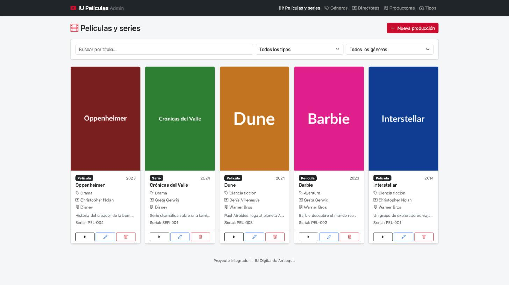
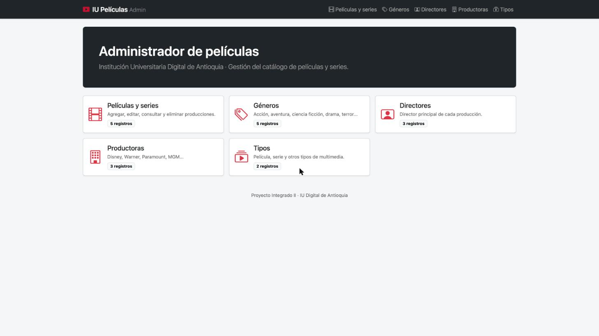
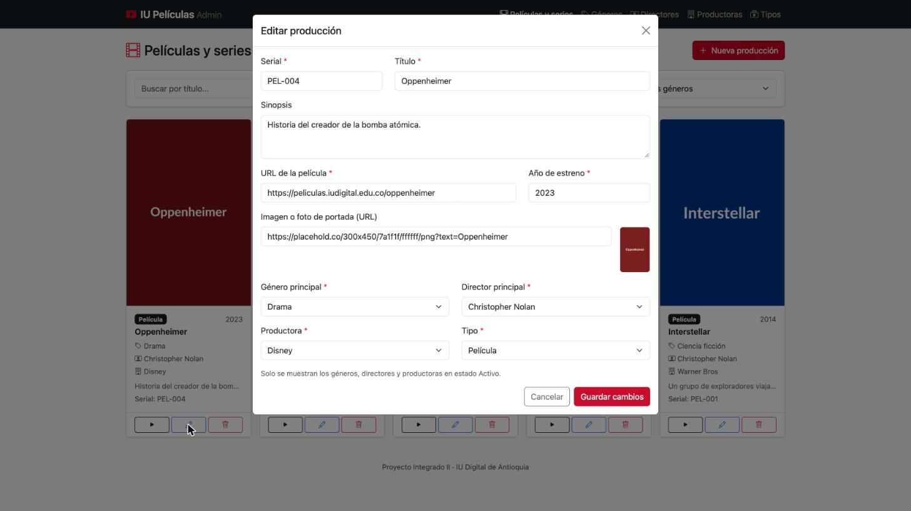
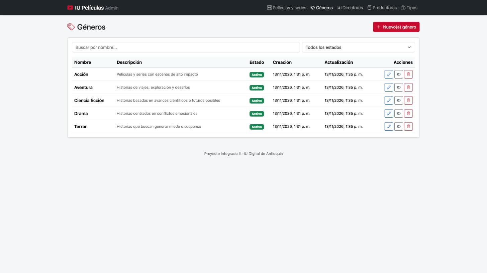
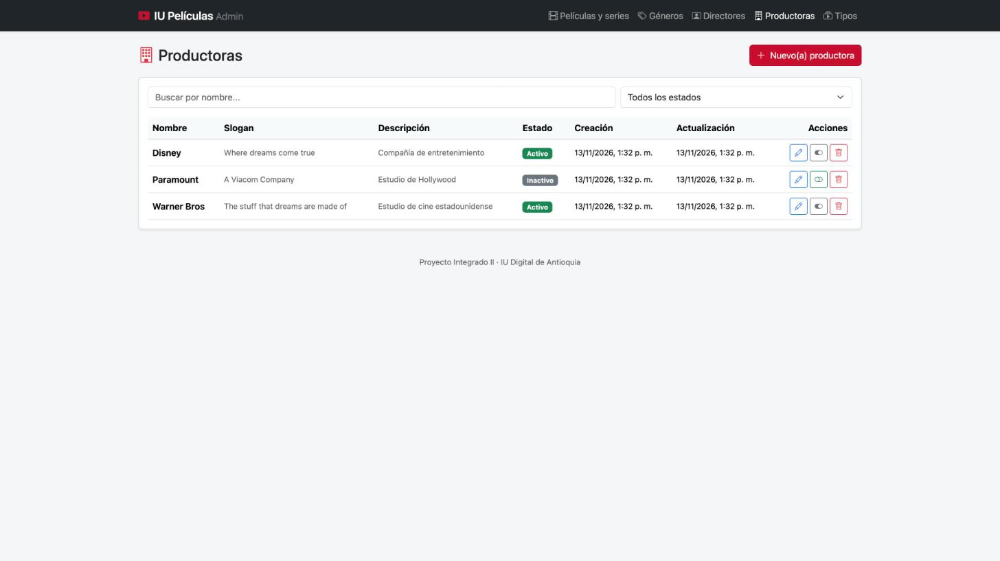

# Frontend Películas y Series — IU Digital de Antioquia

Aplicación web en **ReactJS** para administrar el catálogo de películas y series del caso de estudio *"Aplicación web de películas en modo Administrador"* del curso **Proyecto Integrado II – Desarrollo de Aplicaciones Web** (Evidencia de Aprendizaje 2).

La aplicación consume la API REST construida en la EA1 (proyecto `api-peliculas`) y tiene una pantalla por cada módulo del caso: **Género, Director, Productora, Tipo y Media (películas y series)**. En todas se puede **crear, listar, buscar, editar y eliminar** registros, y en los módulos con estado también activarlos o inactivarlos.



## Tecnologías

| Librería | Uso |
|---|---|
| [React 19](https://react.dev/) + [Vite](https://vite.dev/) | Interfaz de usuario y servidor de desarrollo |
| [React Router](https://reactrouter.com/) | Navegación entre las pantallas de los módulos |
| [Axios](https://www.npmjs.com/package/axios) | Comunicación con la API REST |
| [SweetAlert2](https://sweetalert2.github.io/) | Mensajes de éxito, error y confirmación de borrado |
| [Bootstrap 5](https://getbootstrap.com/) + Bootstrap Icons | Estilos, tablas, formularios y diseño adaptable |

## Pantallas

| Ruta | Pantalla | Funcionalidades |
|---|---|---|
| `/` | Inicio | Accesos a los módulos y número de registros de cada uno |
| `/medias` | Películas y series | Tarjetas con portada; búsqueda por título y filtros por tipo y género; crear, editar, ver y eliminar. El formulario solo ofrece géneros, directores y productoras **activos** y los tipos registrados |
| `/generos` | Géneros | Tabla con nombre, descripción, estado y fechas; crear, editar, activar/inactivar, eliminar; búsqueda y filtro por estado |
| `/directores` | Directores | Nombres, estado y fechas; mismas operaciones |
| `/productoras` | Productoras | Nombre, slogan, descripción, estado y fechas; mismas operaciones |
| `/tipos` | Tipos | Nombre, descripción y fechas; crear, editar y eliminar |

Las validaciones y reglas de negocio de la API se muestran al usuario con SweetAlert2, por ejemplo: serial o URL repetidos, campos obligatorios, o el intento de eliminar un género que está asignado a una película.

| Inicio | Editar producción |
|---|---|
|  |  |
| **Géneros** | **Productoras** |
|  |  |

## Estructura del proyecto

```
src/
├── main.jsx                 # Punto de entrada: BrowserRouter, Bootstrap y estilos
├── App.jsx                  # Barra de navegación y rutas de las pantallas
├── index.css                # Estilos propios
├── services/
│   ├── api.js               # Instancia de axios y servicios CRUD de cada módulo
│   ├── alertas.js           # Alertas de SweetAlert2 (éxito, error, confirmación)
│   └── formato.js           # Formato de fechas
├── components/
│   ├── Navbar.jsx           # Menú principal
│   ├── CrudCatalogo.jsx     # Pantalla reutilizable de catálogo (tabla + formulario modal)
│   ├── Modal.jsx            # Ventana modal de Bootstrap controlada por React
│   ├── EstadoBadge.jsx      # Etiqueta Activo / Inactivo
│   └── Cargando.jsx         # Indicador de carga
└── pages/
    ├── InicioPage.jsx
    ├── MediaPage.jsx        # Catálogo de películas y series
    ├── MediaForm.jsx        # Formulario de película/serie
    ├── GeneroPage.jsx
    ├── DirectorPage.jsx
    ├── ProductoraPage.jsx
    └── TipoPage.jsx
```

## Instalación y ejecución

Requisitos: Node.js 20.19 o superior y la API de la EA1 en ejecución.

1. Levantar la API (proyecto `api-peliculas`):
   ```bash
   cd api-peliculas
   npm install
   npm run dev:memory     # o npm start con MONGO_URI configurado en .env
   ```
2. Levantar el frontend:
   ```bash
   cd frontend-peliculas
   npm install
   cp .env.example .env   # opcional: cambiar VITE_API_URL si la API no está en http://localhost:4000/api
   npm run dev
   ```
3. Abrir `http://localhost:5173`.

Para generar la versión de producción: `npm run build` (los archivos quedan en `dist/`).

## Integrantes

- Simón Castaño Ríos
- Juan Pablo Gonzalez Gil
- Luisa Fernanda Gómez Quiroz
